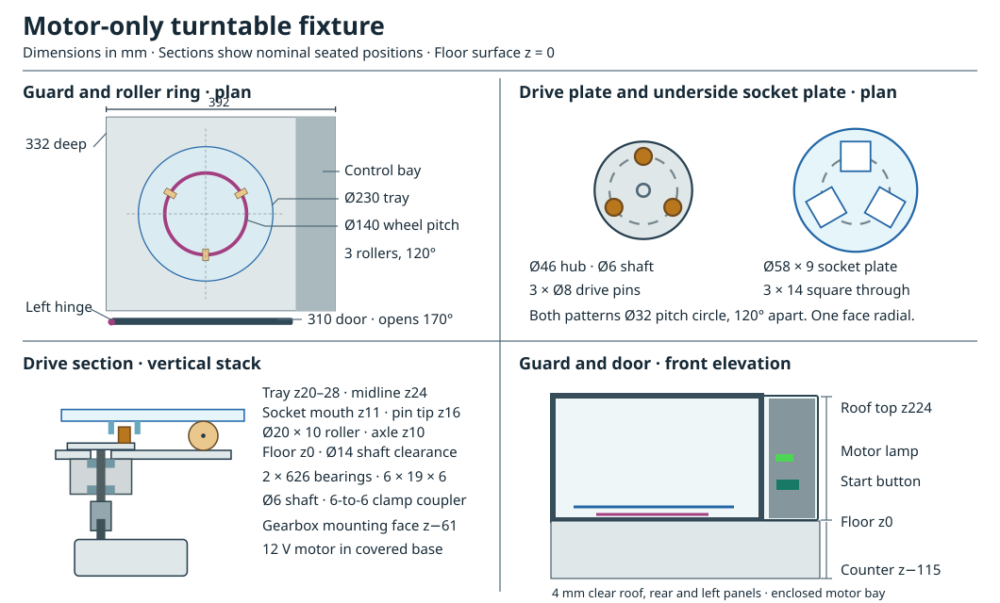

# Build the unheated turntable fixture

All dimensions are in millimetres. The floor surface is z = 0. The rig uses a standalone 12 V drive and an external enclosed power supply. The clear roof, rear and left panels give the cameras a direct view of the roller ring under the tray. The design has been exercised in simulation. Physical assembly and commissioning are pending.

## Parts and estimated cost

| Qty | Part or material | USD allowance |
|---:|---|---:|
| 1 | Aslong JGY370-12-6, 12 V brushed worm gearmotor, nominal 6 rpm, Ø6 D shaft. [Manufacturer listing and drawing](https://www.robotshop.com/products/aslong-motor-jgy370-12v-6rpm-high-torque-worm-gear-motor) | 8.59 |
| 1 set | Enclosed, current-limited 12 V DC, 1 A adapter and matching barrel jack | 14 |
| 1 each | 5 V ATmega328P Nano-compatible board and 12 V to 5 V regulated buck converter | 12 |
| 1 each | Normally-open roller-lever door switch rated ≥2 A at 12 V DC, green momentary Start button, 12 V green indicator, 1 A inline fuse and holder | 13 |
| 1 set | IRLZ44N logic-level MOSFET, SB560 flyback diode, 100 Ω, 100 kΩ, 22 kΩ and 10 kΩ resistors, terminals and wire | 6 |
| 2 + 1 set | 626-2RS bearings (6 × 19 × 6), Ø6 × 50 steel shaft, 6-to-6 split-clamp coupler 20 long, bearing block | 15 |
| 1 sheet | Clear polycarbonate, 610 × 915 × 4, for roof, rear, left panel and door | 32 |
| 1 set | 6 mm birch deck, covered riser, 3 mm aluminium motor bracket, frame angles, screws, two hinges and handle | 19 |
| 1 | Clear PMMA tray blank Ø230 × 8, edges rounded | 14 |
| 1 set | PETG or nylon for the ring, forks, socket plate and hub, three Ø8 pins, three nylon rollers, three Ø3 axles, epoxy and track strips | 10 |
| 1 set | Empty orange ceramic mug Ø62 × 70, about 190 g, silicone-topped drying posts, paint or film for marks | 9 |
| | **Estimated materials** | **152.59** |

Only the motor line uses a vendor price. The other lines are shop allowances. Cameras, robot arms, tools, shipping and labor are excluded.

## Mechanical assembly

1. Cut a 332-deep × 392-wide deck. Mark the axis 166 from its front and 170 from its left edge. Set the deck top 115 above the counter. Fit fixed ring guides of half-round profile, radius 3.8, on concentric radii 57 and 84. Leave the space underneath for the motor and cover its sides and bottom.
2. Drill a Ø14 shaft clearance at the axis. Under the deck bolt a 42 × 42 × 24 bearing block using four M3 screws on a 32 square. Bore Ø12 through and seat one Ø19 × 6 bearing flush in each end. Run the Ø6 shaft through both. A Ø46 hub has a flat top at z5, underside at z0.5 and a Ø12 neck reaching z−5. Secure the neck to a flat on the shaft with an M3 radial screw. Fit the three Ø8 drive pins at 120° on a Ø32 bolt circle, with 11 exposed above the hub. One pin points toward the back at reset.
3. Clamp the spindle to the motor with the 20-long coupler centered at z−45. Set the motor gearbox face at z−61, with about 1 mm between shaft tips. Align the motor output with the bearings before tightening. Transfer the motor's four mounting holes from its gearbox face to the bracket. Check free rotation of the spindle with the coupler loosened.
4. Bond a Ø58 × 9 socket plate to the tray underside, concentric within 0.5. Cut three 14 × 14 through pockets on the same Ø32 pattern. Orient a pair of pocket walls parallel to each local radius. The tray underside rides at z20 and the pocket mouths at z11. A seated pin overlaps its pocket by 5 vertically with 3 lateral clearance per side. Rotate the tray gently by hand with power disconnected to check the fit.
5. Make a Ø140 pitch-diameter hoop with a 6.8 round section. At three equally spaced positions interrupt the hoop over 26 tangential length. Bridge each opening with two 30-long × 7-high × 2-thick fork cheeks, centered at radii 63.5 and 76.5 and attached to both cut ends. Fit a freely turning Ø20 × 10 nylon wheel between the cheeks on a retained Ø3 radial axle at z10. One roller faces the door at reset. Use a Ø3.2 wheel bore for free running. With the ring in place all wheels run on the deck and the tray midline sits at z24. The simulator approximates the hoop and fork junctions with a continuous hoop.
6. Mount the roof with its upper face at z224, the clear rear and left walls at 159 behind and 156 left of the axis, and an enclosed control bay on the right. Fix the 310-wide, 221-high windowed door to a vertical hinge 185 forward and 161 left of the axis. Set its open stop to 170°. Fit a vertical handle 290 from the hinge and 35 forward of the closed door. Fit the Start button 175 forward and 205 right of the axis at z59. Set the door switch so it opens when the mark 300 from the hinge moves more than 10 from its closed position. Align a fixed ±10 green witness strip beside the blue door mark. The door closes the front access opening.
7. Paint the hoop centerline magenta and the tray mid-edge dark. Put an 8-wide blue stripe on the tray top from radius 95 to 115 and wrap it onto the edge. Put a blue center dot on the tray and a Ø10 yellow dot at the inside bottom of the mug (7 above its foot). Center a 5-radius reticle on the roof. Mark the fixed ring limits at radii 58 and 82, the mug limits at 35 and 78, and four cardinal ticks at radius 129. Fit rear and left 5 mm rulers with contrasting bands at z7–13 and z21.5–26.5. The plan shows the blue latch tab beside the motor lamp and the fixed green witness strip.

## Drive wiring and first run

Use only this low-voltage assembly. Connect the external adapter to the fixture after fitting the guard and closing the motor bay. No microwave oven or heating hardware is required.

| Connection | Wiring |
|---|---|
| Input | Jack positive → fuse → +12 V bus. Feed the Nano's regulated 5 V pin through the buck. Tie logic and adapter grounds together. |
| Door cutout | +12 V bus → door switch COM. Switch NO → motor positive. The switch conducts only with the door closed. Sense its output at D3 through 22 kΩ, with 10 kΩ from D3 to ground. |
| Motor switch | Motor negative → IRLZ44N drain. Source → ground. D9 → 100 Ω → gate, with 100 kΩ gate-to-ground. Fit SB560 directly across the motor, striped end to motor positive. |
| Visible controls | Start button between D2 and ground. Connect the polarized 12 V indicator across the motor terminals so it shows switched motor power. Mount it where it can be seen from above and in front. |

Load the [30-second timer sketch](drive_timer/drive_timer.ino) on the Nano. With the door open, press Start and verify the lamp stays dark. Close the door, release and press Start. The lamp and motor should run for 30 s. Open the door partway through and check that the lamp and motor turn off immediately. Reclosing must require a new press. Verify counterclockwise rotation from above and roughly 10 s per loaded turn before collecting trials. Disconnect the adapter before adjusting pins, rollers, wiring or motor polarity.
