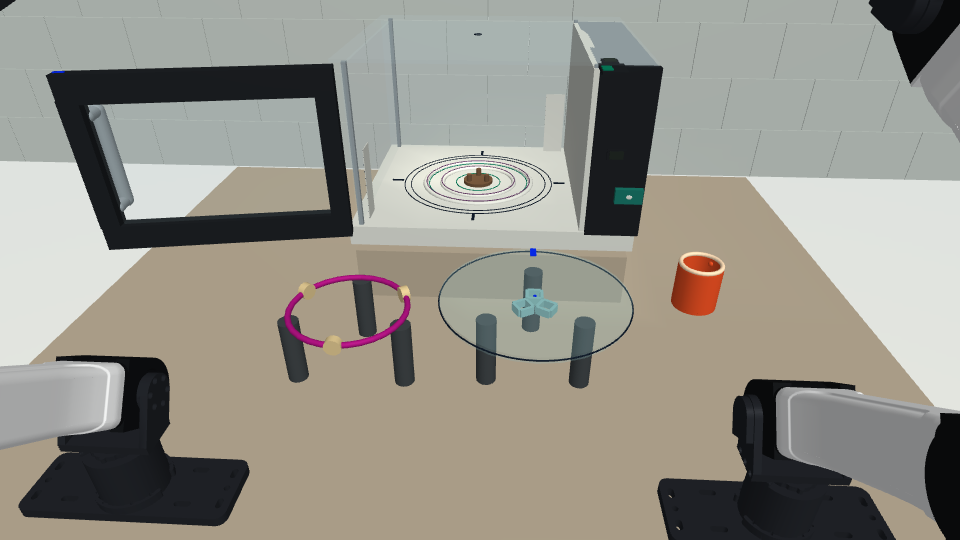
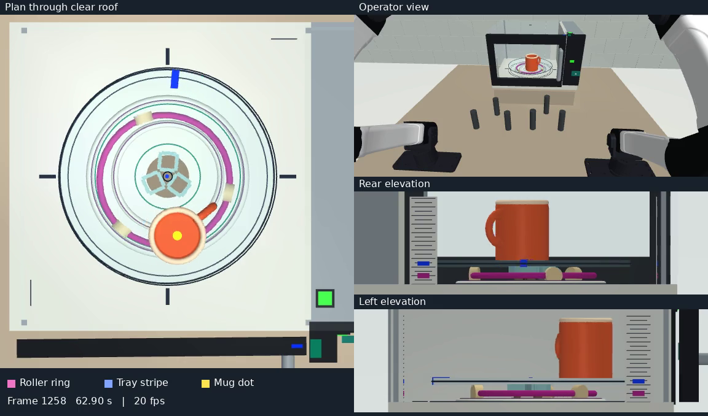

# Reinstall a microwave turntable after cleaning

Center the roller ring, seat the clear tray on the three drive pins, and put the orange mug off center. Close the door and press the green Start button. The installation passes when the marked tray and mug ride one uninterrupted revolution together. The standalone fixture reproduces the installation order of a household microwave and powers only the turntable. [Whirlpool installation guide](https://producthelp.whirlpool.com/Cooking/Wall_Ovens_and_Ranges/Wall_Ovens_new/Cleaning_and_Maintenance/Microwave/Cleaning_the_Turntable_-_Wall_Oven)



The [mechanical drawing](fixture.svg) and [build instructions with parts, interlock and timer](FIXTURE.md) specify an approximately $153 bench fixture. It uses an 8 mm clear acrylic tray in place of glass so the roller ring remains visible. All verification reported below used simulation.

## Setup and reset

Use a 1,100 × 1,100 mm counter. Measure from the midpoint between the two arm bases, with x forward, y left and height above the counter. The bases are 610 mm apart. Set the fixture floor 115 mm high and the drive axis at (525, 0) mm. Open the left-hinged door to 170°, release the Start button and clear the timer. Place the loose parts as follows. Seed 0 restores this fixed layout.

| Object | Center (x, y) mm | Placement |
|---|---|---|
| Roller ring | (202, 136) | Ø140 pitch, three Ø20 × 10 wheels. Axle plane 87 mm high, one wheel toward the robot. Three Ø24 silicone-topped posts at radius 70, angles 0°, 110°, 250° from +x toward +y. |
| Tray | (226, −85) | Ø230 × 8, about 400 g with the three sockets. Midplane 93 mm high, blue stripe along +x. Three Ø24 posts at radius 69, angles 0°, 125°, 235°. |
| Empty mug | (365, −322) | Ø62 × 70, 190 g, upright on the counter. The handle points diagonally forward and to the robot's right (+x, −y). |

## Score a trial from video



Record the fixed overhead view through the roof, level views through the rear and left panels, and the operator view showing the door, lamp and hands. Synchronize the views at 20 fps. Square the cameras to their respective planes. For perspective cameras, calibrate with a ruler at each measured plane or use a long-lens view and verify the scale at both edges. The four overhead tick centers sit 129 mm from the axis. Adjacent minor ticks on the elevation rulers span 5 mm.

Award the **highest cumulative placement still present on the final frame**. For each credited part, require a 5 mm visible gap to the robot. Trace the center of the magenta hoop and the tray's marked mid-edge. In plan, use the midpoint of opposite edges or fit the visible arc if the mug covers one side. The fixed 5 mm roof reticle and the floor circles show the centering limits.

| Score | What to check |
|---|---|
| 0 | The ring fails any of its checks. |
| 0.25 | Released ring center within 12 mm of the axis. Its midline is 10 ± 3 mm above the floor and its tilt is at most 4°. Use the magenta height band and the radius-58 and radius-82 guides. |
| 0.50 | Also require a released tray centered within 5 mm, with its mid-edge at 24 ± 2.5 mm and tilt at most 2°. The center of the blue dot lies inside the roof reticle and the mid-edge aligns with the blue height band. |
| 0.75 | Also require a released mug with the yellow dot 35–78 mm from the fixed axis. Its axis is within 5° of vertical and its foot center is within 2 mm of the tray's top plane. |
| 1.00 | All three placements persist through the complete powered turn below. |

For height, average the two opposite rim heights. For tilt, measure the slopes of the ring or tray center plane in both elevations. The total tilt is `atan(hypot(rear slope, left slope))`. Use the same calculation with the mug's centerline and vertical, using the foot and lip centers. The 5 mm elevation ticks span 7 pixels in the published video and the 5 mm overhead reticle radius spans about 7.6 pixels.

**Loaded turn.** Begin on a frame with all three placements, a lit motor lamp, the blue door tab aligned within the fixed ±10 mm latch strip, and all four fingertip pads outside the guarded compartment. Use the fixed overhead ticks for orientation. Note the stripe and yellow dot's individual starting bearings. Follow each counterclockwise across 90°, 180°, 270° and 360° of travel from its own start. Both must reach 360° and be within 8° of their respective starts on the same frame.

Loss of placement, power or door closure resets the count. A gripper entering the compartment also resets it. Apply these limits to the visible marks.

- Either mark advances less than 4° over any 10 frame intervals (0.50 s), or backs up more than 4° from its furthest bearing.
- Their cumulative advances differ by more than 8°, or either mark skips a whole quadrant between recorded frames. A real-video gap that hides a mark also ends that interval.

The loaded demo averaged about 31°/s, or 5.2 rpm, including take-up after Start. A half-second normally shows about 16° of travel. The scorer reads the geometry of these visible marks, the hand-to-part gaps, and the lamp and latch. Only the independent spindle is actuated. The three loose parts move through contact. The door switch cuts power on opening and a fresh Start press with the door closed starts a 30-second cycle.

## Run and reproduce

Use the configured YAM environment (Python 3.12, MuJoCo 3.11, Inspect Robots 1.0, YAM Arena `0059d02`). From the RoboCurve workspace, run with a new output directory. On another installation the same Python entry points use the activated environment and EGL.

```bash
task_dir=worktrees/microwave-turntable/tasks/microwave-turntable
./scripts/run_on_gpu.sh 0 python "$task_dir/demo.py" --record --out runs/microwave-full-new
```

The command creates the synchronized H.264 recording, reset image, per-action trace and terminal result. Add one of `--miss-hub`, `--interrupt`, or `--stop-after ring|tray|mug` to reproduce a control. For an authorized hosted evaluation, use `dream_run.py --out <fresh-directory>` with the same launcher.

Both policies issue 14 absolute joint and gripper targets at 20 Hz. The scripted policy uses fixed setup geometry and robot-only inverse kinematics. Dream-1 receives the two wrist cameras and top camera at 320 × 176, joint positions, gripper openings and the instruction. The inspection cameras and evaluator measurements are for grading. The physics timestep is 2 ms. A trial allows 1,400 actions or 70 simulated seconds.

## Asset sources

- The installed `yam_arm.urdf`, visual STLs under `assets/`, and collision meshes under `collision/` come through YAM-inspect-Isaac and the YAM Arena adapter. The adapter records the I2RT Robotics model revision as `120c3c81400171174604e503943f8d1ebc891058` and identifies the model assets as MIT-licensed. Copyright © I2RT Robotics. [I2RT source](https://github.com/i2rt-robotics/i2rt/tree/120c3c81400171174604e503943f8d1ebc891058/i2rt/robot_models/arm/yam/v1) · [Pinned URDF and meshes](https://github.com/kairosiann/yam-isaac-lab-arena/tree/0059d02a1a91bc6834c1d0846022891df0c78730/yam_arena/assets/yam) · [MIT notice](LICENSE.i2rt)
- The black and white STLs for links 2 and 3 are splits of I2RT geometry from the `dreamlabs` 1.0.23 wheel, directory `dream_examples/yam_mujoco/assets`. Its adapter manifest gives the four file hashes and the same I2RT MIT notice. [Split-mesh manifest](https://github.com/kairosiann/yam-isaac-lab-arena/blob/0059d02a1a91bc6834c1d0846022891df0c78730/yam_arena/assets/yam/dream/SOURCE)
- The task imports the station geometry, robot frames and calibration from adapter revision `0059d02a1a91bc6834c1d0846022891df0c78730`. That revision lists its repository-wide license as pending. The task loads the arm files from the installed dependency. The fixture geometry and markings are generated by this task. [Adapter license statement](https://github.com/kairosiann/yam-isaac-lab-arena/blob/0059d02a1a91bc6834c1d0846022891df0c78730/README.md#license)

## Recorded results

| Scripted trial, seed 0 | Score | Actions | Visible outcome |
|---|---:|---:|---|
| Complete installation | 1.00 | 1,258 | The lamp stays on and both marks complete the turn. |
| Stop after ring | 0.25 | 280 | The ring is released and the tray is on its posts. |
| Stop after tray | 0.50 | 572 | The ring and tray are seated. The mug remains on the counter. |
| Stop after mug | 0.75 | 817 | All three placements are visible. The motor lamp is dark. |
| 18 mm missed-hub control | 0.25 | 1,400 | The tray finishes 52.3 mm off axis. Common loaded travel is 0.0°. |
| Door opened during rotation | 0.75 | 1,400 | The door cuts power on frame 1,151 after 189.6° of common travel. The count returns to zero. |

An independent color readback of the exported MP4 uses the four fixed ticks, blue stripe and yellow dot. The lamp lights on frame 1,026. Both marks first pass their successive quarter turns on frames 1,088, 1,144, 1,202 and 1,258. The video gives 361.8° for the tray and 361.1° for the mug, with at most 1.2° relative slip. The full recorded trial took 62.9 simulated seconds and about 15 seconds of wall time. [Measured trial results](results.json)

The prior Dream-1 trial scored 0.00 on the original fixture. A model evaluation and task-board media ID for the revised camera images are pending.
