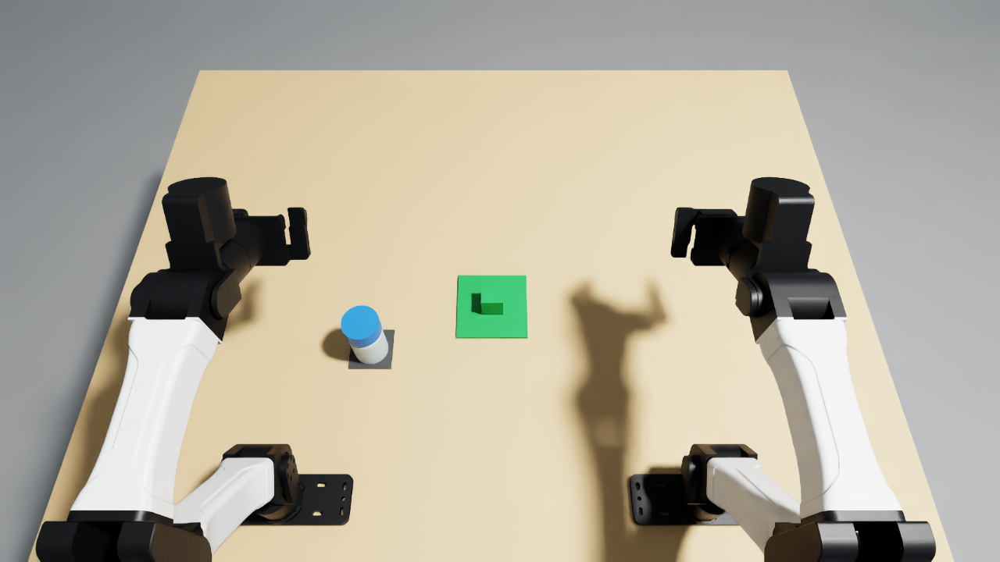

# Park a reagent cap without touching its interior

Lift an already-unscrewed reagent cap from its bottle and leave it **inside-up,
released and stable on the green rest**, protecting its inside and opening rim
throughout. The bottle is empty and secured in a holder. There are no threads,
liquids, flexible parts or custom mechanisms.

This isolates contact-sensitive cap handling. It does not measure sterility,
airborne contamination, dispensing, or unscrewing. The explicit inside-up rule
is consistent with this [University at Buffalo laboratory protocol](https://markelz.physics.buffalo.edu/node/348).
Handling protocols differ; this is a physical contact-avoidance benchmark, not
a claim that inside-up parking alone establishes asepsis.

## Scene and assets

The **ChemLab-Assets 100 mL GL45 bottle and separate cap** supply the visual
meshes and primitive collision proxies. `assets/body.usda` and `assets/cap.usda`
are checked in, so running the task requires no asset downloads. The original
OBJ meshes and URDF parts are in `source_assets/`. The bottle is fixed and
rendered opaque for visibility. The cap is a free rigid body with its hollow
interior retained, not a solid-cylinder approximation.

The new holder and cap rest use three fixed boxes. The rest has a 36 mm square
top, 50 mm above the bench, on a 120 mm square base. Its narrow top supports the
cap's closed exterior while leaving the fingers room to open. These dimensions
are intentional and reproducible with a simple plastic block. The cap is
58 mm in diameter, 27 mm high and 27.2838 g. `task.json` lists the full layout,
materials and dimensions; the table surface is z = 0.7475 m.

The initial cap pose is allowed to settle onto the bottle neck during reset.
The bottle centre is (0.240, 0.200) m; the rest centre is (0.320, 0.000) m.
Coordinates use x forward, y left and z up. No scene jitter is used.
For physical reproduction, secure an empty bottle, loosen its cap completely,
and use inert materials only. No consumables are needed.



## Score

The score is evaluated at the end, with a persistent clean-removal milestone
and persistent failure flags:

- **0.25:** the whole cap has cleared the bottle's 100 mm neck by at least 20 mm,
  without a prohibited contact or fall.
- **1.0:** that removal plus two continuous seconds with the cap centre within
  20 mm of the rest centre, its lowest point within 3 mm of the rest top,
  opening upward within 15 degrees, translational speed below 10 mm/s and
  angular speed below 0.2 rad/s. During the interval its centre stays within
  2 mm and orientation within 3 degrees of the interval's initial pose.
- **0 permanently:** an interior or opening-rim contact with a robot or any
  fixture other than the bottle, or a fall with its centre outside x = [-0.19, 0.91] m or y = [-0.65, 0.65] m, or its lowest point more
  than 10 mm below the table. Invalid measurements/contact-monitor errors also
  fail closed. Reset clears all history.

Full credit also requires no contact with any robot link in the preceding
control interval, and every finger-link origin over 70 mm from the cap centre.
This is a conservative release check; it does not use commanded gripper state.
A held, moving, wrong-side or wrong-location cap cannot earn full credit.
Removing a credited cap removes full credit immediately. A clean earlier
removal can retain 0.25. No action sequence or arm assignment is required.

`monitor.py` reads actual PhysX contact points after **every 240 Hz physics
substep**, including all links of both robots, the table, rest and other
fixtures. Only the bottle is excluded because its neck initially contacts the
cap. The cap's local origin is the opening centre; +z points toward its closed
top. The protected interior is r <= 24.1 mm and -1 <= z <= 24.6 mm. The opening
rim additionally covers r <= 30.5 mm and -1 <= z <= 1 mm. Contact separation up
to 0.5 mm counts. These conservative bands are specified in `task.json` and
include the full opening edge, not only the inner ceiling. Exterior side-wall
and closed-top contacts are allowed. A contact violation cannot be repaired by
later placing the cap correctly.

Pose scoring runs once per 20 Hz action. It only reads measurements and
history. The native extra success hold is disabled because the scorer already
requires its own two seconds. Physical outcomes can be checked from video,
a ruler and an angle reference; no microbiological assay is claimed.

## Run on the RoboCurve Brev launchable

```bash
source ~/IsaacLab-Arena/yam.env
cd /path/to/tasks/reagent-cap-clean
python -m unittest discover -s . -p 'test_*.py' -v
python validate.py --episodes 3 --out ~/cap-runs/demo
python negative.py --out ~/cap-runs/wrong-side
python run_trial.py --out ~/cap-runs/dream
```

Output directories must be new. `run_trial.py` uses the hosted **Dream-1**
policy, the exact instruction in `specification.py`, `task_score`, seed 0,
`object_jitter=0`, 20 Hz, and a **1,000-step (50-second)** action limit. It uses
the launchable's existing Dream credentials. Dream receives 320 x 176 images.
The underlying cameras render at 1280 x 720, using the standard camera poses.
The demo records that native resolution. CPU PhysX runs on Brev, with GPU
rendering. Recordings are H.264 at 5 fps, sampled every fourth 20 Hz observation
with correct playback timing. JSONL traces retain each action and measurement.

The demonstration controls only robot joint targets through Inspect Robots.
The left arm lifts the cap and turns it 90 degrees, the right grasps its
exterior across the other diameter, the left releases, and the right makes
the remaining quarter-turn and parks the cap. This stays within YAM's wrist
limits. There is no object teleportation, attachment, scripted contact state,
or change to robot drive settings. Gripper targets use a finite 50 mm gap.
The object uses friction 0.8/0.7, 16 solver position iterations and a 6 mm
object-side torsional friction patch, as disclosed in `task.json`.

`negative.py` is a robot-only counterexample that removes the cap and lowers it
mouth-down over the rest. It must trigger the contact latch and score zero.
`test_scoring.py` tests fourteen groups of scorer counterexamples, including
contact zones, idle, held/wrong-side/moving placements, insufficient hold,
missing sensor data, falls and reset history.

To render the standard model recording:

```bash
inspect-robots video /path/to/dream/adhoc_RUN.json
```

To rebuild the assets on Brev (optional; starts a headless Isaac Sim process):

```bash
python build_assets.py
```

The converter preserves source mesh vertices and primitive collision proxy
dimensions, adds USD rigid-body/contact metadata and changes display colours.
It does not use the source screw joint or instrument runtime.

## Recorded validation

Three fresh-reset demonstrations reached **1.0** in **637, 638 and 638
steps** (31.85, 31.90 and 31.90 simulated seconds), within the 1,000-step limit.
All three two-second idle checks scored zero. None of the successful runs
had a prohibited contact or monitor error. The three-run job took 346.96
wall-clock seconds including startup and the idle checks. Maximum planned IK
error was under 0.1 mm and 0.019 degrees for both arms. See
[`evidence/demo.json`](evidence/demo.json) and
[`evidence/idle_checks.json`](evidence/idle_checks.json).

The robot-only mouth-down counterexample scored **0.0**, with a measured
protected-surface contact against the rest. See
[`evidence/negative.json`](evidence/negative.json). All **14 offline scorer
tests passed on Brev**. The demo, negative test and model run used identical
scene and scoring sources; the final manifest checks every recorded hash.

The hosted **Dream-1** run scored **0.0** after **1,000 steps**, ended by
`max_steps`, and recorded no errored trial. Its duration was 206.30 wall-clock
seconds. The CLI seed was 0; Inspect Robots derived trial reset seed
1415158438. With scene jitter disabled this does not change object placement.
See [`evidence/dream.json`](evidence/dream.json) for the exact instruction,
source hashes and API retry count. Six expired-session retries were reported
by the client; the completed run remains a single scored trial. This result
includes any effect of those API retries and is not a broad policy estimate.

The submission video combines the three actual camera streams without
changing playback speed. The demo is 1280 x 1080 at 5 fps; Dream is 640 x 528
at 20 fps, with the 320 x 176 top view enlarged for the layout. The setup image
is the native top-camera view. The precise package versions and YAM Arena
commit are in [`evidence/environment.json`](evidence/environment.json).

Submission media: **M-67HSPZ**, containing the Dream-1 run, full-score demo and matching setup image.

Evidence reports contain source hashes and contact/pose diagnostics. Local
videos and every-step traces are retained under `runs/`, which is excluded from
Git; submission media is uploaded separately to the task board.

The signed-in board check on 2026-11-12 covered 66 accepted entries and 780
pending/revising/planned entries and found no matching objective. Related cap
opening and autoclave-preparation tasks have different goals. This is a dated
availability check; novelty acceptance remains the reviewers' decision.

## Attribution and licenses

Reused asset: **duran_gl45_100ml_clear**, from **ChemLab-Assets v1.5.0**,
Zirui Song, Jiadong Zhang, Jiahao Zhang, Xiaosong Ma, Xiaojun Chang and Xiuying
Chen (2026), [dataset](https://huggingface.co/datasets/MBZUAI/ChemLab-Assets).
Meshes, URDF parts, the contract and their converted USD derivatives retain
[CC BY-NC 4.0](https://creativecommons.org/licenses/by-nc/4.0/).
Research use and redistribution are permitted under that license; the
[RoboCurve guide](https://tasks.robocurve.org/) explicitly allows third-party
noncommercial assets with those permissions. Original license, citation and
notice files are in `source_assets/`; original file hashes are in
`evidence/asset_hashes.json`.

The scene adapter is adapted from this repository's
`tasks/lock-before-loading/scenekit.py`. Contact-view polling follows the
existing `tasks/move-live-wire-with-stick/task.py` pattern. The task's new code
and simple holder/rest geometry are released under MIT; third-party asset
terms are unchanged. Runtime dependencies are the launchable's YAM Arena,
Isaac Lab-Arena, Inspect Robots, NumPy, imageio and Pillow packages.
