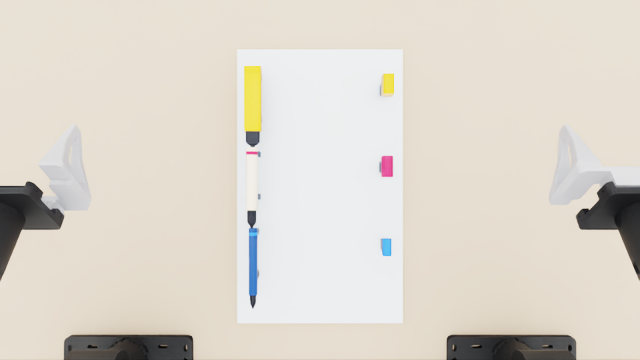

# Recap three writing tools

> Put the blue cap on the slim blue pen, the rose cap on the whiteboard marker with the rose band, and the yellow cap on the rectangular highlighter. Push each cap fully against its barrel shoulder. Release the cap and hold each tool by its barrel alone, cap pointed down and clear of everything else, for two continuous seconds. Leave all three caps seated.

**Societal relatability.** Recapping shared writing tools gets them ready for the next person and keeps markers from drying out. Each pair starts separated. The robot coordinates the two pinches, guides the cap onto the writing end, pushes to the shoulder, and then transfers the weight of the cap to the friction fit. The rectangular highlighter also needs roll alignment.



[Recorded YAM demo](evidence/demo.mp4) · [Measured results](evidence/rollout-results.json) · [Live board comparison](evidence/board-check.json)

## Fixed reset

Use the 800 × 1,200 mm YAM tabletop. The midpoint between the two arm bases is the horizontal origin. Positive x is forward and positive y is left. The tabletop is at world z = 750 mm. Both arms start in the ready pose with grippers open. The fixed polymer pickup tray is 430 × 260 mm, spans x = 55–485 mm and y = −130 to +130 mm, and has a 5 mm thick base. The tops of its small open rests are 35 mm above the worktop. Each barrel rests on two 8 mm long blocks with centres 46 and 112 mm from the nib. Each cap rests on a 16 mm long block centred under its mid-length. The blocks are 78% of the corresponding tool's reset width across y. They support loose parts from below during pickup. Both parts leave the rests before seating.

All dimensions in the table are in mm. Reset coordinates are measured from the stated origin with heights above the worktop. Use the nib end as the barrel reference and the middle of the closed face as the cap reference. Each barrel nib faces −x and each cap mouth faces +x. Seat a flat face on the rests. The highlighter barrel has its broad face down and its loose cap has its narrow face down, a 90° roll difference.

| Pair | Plastic barrel size and mass | Hollow plastic cap size and mass | Barrel reset (x, y, height) | Cap reset (x, y, height) |
|---|---|---|---|---|
| Slim pen, blue | 120 × 12.5 across flats, 15 g | 25 × 12.9 across flats, 1.5 g | (88, +100, 41.35) | (167.5, −100, 41.55) |
| Whiteboard marker, rose band and cap | 120 × 16.7 across flats, 15 g | 32 × 17.1 across flats, 3.3 g | (208, +100, 43.45) | (284, −100, 43.65) |
| Rectangular highlighter, yellow | 120 × 24.7 × 15.5, 15 g | 29 × 25.1 × 15.9, 3.2 g | (328, +100, 42.85) | (405.5, −100, 47.65) |

The listed poses include 0.1 mm of drop clearance. The simulator settles the loose objects for 0.5 seconds before the first action. Exact settled poses from the recorded trial are in the results. The reset is the same for every seed.

## Scoring

Each correct cap earns one third. Any pair order and either assignment of grippers are valid.

1. Seat the cap while one hand pinches its matching barrel and the other pinches the cap. The rim must lie within 0.60 mm of the barrel shoulder plane all the way around, including the simulator's signed contact tolerance. The cap mouth centre must be within 0.90 mm of the barrel axis. The two axes must be within 4° of each other, and the highlighter's long cross-sectional axes must agree within 5° modulo a half-turn.
2. Release the cap. Hold by the barrel alone for 2.00 continuous seconds. Both axes must be within 12° of cap-down vertical, and the cap's lowest point must be at least 10 mm above the tops of the rests. Only the barrel's gripping hand may load the assembly externally. The cap touches its matching barrel alone.
3. Keep the cap seated through the final sample. A later unseat revokes credit. Another bimanual seat and uninterrupted hold can restore it. After proof, the tool may be put down. The run ends when all three pairs have credit or the 1,200-action limit is reached.

[The scorer](scoring.py) transforms the authored cap rim and barrel shoulder into world coordinates and checks the most open and most compressed points of the seam. It uses separately filtered PhysX contact forces for the two pads of each gripper, all tools, the other robot links, the tray, table and floor. A pinch needs two opposed pad forces of at least 0.08 N each. During the proof every disallowed contact pair must carry under 0.003 N of measured normal force. [The recorder](physics_monitor.py) reads after every physics step. A passing window spans 240 intervals at 120 Hz, with 241 qualifying samples.

For a real trial, mark the three reset rows and matching caps using the layout above. Use two close-up views around the tool with a calibrated millimetre reference. Check the grip on each piece while it seats, then check the shoulder seam all around with a 0.60 mm feeler or calibrated close-up. Use the view along the tool and the side views to check coaxial alignment and the highlighter flats. Set a vertical line and a height mark 10 mm above the rests in the side view. Time two uninterrupted seconds from the first frame with the cap free, the barrel alone held, and the tool inside the angular and height limits. The videos also show that the cap remains clear and seated throughout the hold. Check the seam again at the end.

## Contact model

The scene uses the three profiles from the workspace's `runs/pen-cap-contact/probe.py` and its GPU fixture measurements in `gpu-validated.json`. A stepped tapered nose and flared opening guide the fit. Each cap has a closed end, hollow relief, and four compliant colliders around a 6 mm friction band. The hard shoulder bears on the cap rim and leaves nominal axial nib clearance of 2.2 mm on the pen and 3.2 mm on the two markers. All six pieces are independent rigid bodies throughout the rollout. The only actuators are the YAM joints and grippers.

The compliant collar overlaps the barrel land by 0.18 mm per side on the pen and highlighter and 0.30 mm on the marker. The band uses 1,600 N/m normal stiffness, 1 N·s/m damping, and minimum-combined plastic friction with coefficients 0.45 static and 0.36 dynamic. The workpiece colliders use a 0.25 mm contact offset, zero rest offset and 24/4 position/velocity solver iterations per body. The arm colliders use a 0.50 mm contact offset to give the jaws room for shallow tabletop grasps. The model uses GPU PhysX at 120 Hz and holds each 20 Hz command over six substeps. The workspace fixture controls showed instability with CPU friction.

The shell geometry uses octagonal and 16-sided approximations for round sections and a chamfered rectangular profile for the highlighter. The compliant contacts approximate the force from a squeezing plastic skirt. Retention depends on friction and surface geometry. The model uses simplified nibs, rigid outer shells and open pickup rests. Plastic flex, commercial insertion and pull-off forces, and air sealing remain unmeasured. The trial demonstrates cap retention under the modeled cap's own weight.

## Measured rollouts

The full scripted trial scored **1.0 in 1,016 of 1,200 actions** (50.80 simulated seconds, about 85 seconds wall time on a local RTX 5090). A second run on the same GPU also scored 1.0 in 1,016 actions. The film shows the top view above the left and right wrist views. The demo puts the pen and whiteboard marker down after their holds and finishes holding the highlighter cap-down.

The Dream-1 trial scored **0.0 in 1,200 actions**. All three caps were unseated at the final sample. This trial used the same task and seed with `--policy dream --epochs 1` and 320 × 176 camera observations. [Model result](evidence/dream-1.json)

| Tool | First passing hold, inclusive action range | Largest rim gap during that 2 s | Lowest cap clearance above rests | Largest rim gap at trial end |
|---|---:|---:|---:|---:|
| Blue pen | 202–242 | 0.088 mm | 139.25 mm | 0.027 mm |
| Rose whiteboard marker | 589–629 | 0.092 mm | 134.48 mm | 0.141 mm |
| Yellow highlighter | 976–1,016 | 0.362 mm | 139.71 mm | 0.354 mm |

The two negative controls each ran 277 actions and scored **0.0**. Both used the same entry point and scorer and attempted only the whiteboard marker.

- **Partial seat.** A 5.65 mm shorter commanded stroke left a measured 3.42–3.44 mm centre gap. The cap hung clear without external contact for 3.79 seconds and stayed on through the end.
- **Separation.** The marker's writing end used a 0.008 static coefficient in this control, so the collar contacts had lower friction and the gripper contacts on the main barrel were unchanged. The cap reached the shoulder while both hands held it. After release, the maximum rim gap measured 0.171 mm on the first unsupported sample and 0.625 mm one physics step later (8.3 ms). The cap fell onto the tray before the hold could pass.

The regression tests also interrupt an otherwise qualifying hold mid-window, and check that a cap that unseats after a completed proof loses its credit.

## Reproduce locally

Start from this worktree's repository root using the workspace environment described in `RUN_LOCAL.md`. Use an available physical GPU index. The recorded full rollout used GPU 0. The two negative controls used GPU 1. The USD files ship with the task, and `python "$task/build_assets.py"` regenerates them in the activated environment.

```bash
workspace=$(cd ../.. && pwd)
task="$PWD/tasks/recap-writing-tools"
runs=$(mktemp -d "$workspace/runs/recap-writing-tools-XXXXXX")
instruction=$(jq -r .instruction "$task/task.json")

trial() {
    local mode=$1 gpu=$2 width=$3 height=$4 frames=$5
    local output="$runs/$mode"
    mkdir -p "$output"
    RECAP_CONTROL="$mode" RECAP_TRACE="$output/trace.jsonl" \
        "$workspace/scripts/run_on_gpu.sh" "$gpu" inspect-robots run \
        --embodiment yam_arena --policy yam_scripted \
        -E "task=$task/task.py" -E object_jitter=0 -E control_hz=20 \
        -E "cam_width=$width" -E "cam_height=$height" \
        --instruction "$instruction" --seed 0 --scorer task_score \
        --max-steps 1200 "$frames" --no-prompt --no-rerun --no-live-log \
        --log-dir "$output"
}

trial normal 0 640 360 --store-frames
trial partial 1 320 180 --no-store-frames
trial separation 1 320 180 --no-store-frames

source "$workspace/env.sh"
python "$task/verify.py" --normal "$runs/normal" --partial "$runs/partial" \
    --separation "$runs/separation" --out "$runs/results.json"
(cd "$task" && python -m unittest -v test_scoring)
inspect-robots video "$runs"/normal/adhoc_*.json --out "$runs/video"
```

The task file loads with the pinned YAM adapter (`0059d02`) on the local IsaacLab-Arena 0.3.1 environment. The task-local adapter extends it with compound USD loading and post-physics monitoring. The scripted policy starts from the disclosed reset geometry, plans TCP poses with URDF kinematics, and trims joint tracking using public `joint_pos` observations. Physics object transforms and contact forces enter the scorer and diagnostics only. [Task entry point](task.py) · [Scripted YAM controller](demo.py)

## Duplicate check

The signed-in live board was refreshed at 14:33:16 UTC on 21 November 2026. The preceding 48 hours contained 80 accepted tasks and 209 non-final rejected tasks by review timestamp. The closest match was the inhaler recap after removing a lodged coin, with a seat-depth check, a light pull and hands-off tray placement. The writing-tool task uses three free pairs, a rectangular roll alignment and a separate two-second gravity hold while gripping each barrel. Other in-window mechanical analogues were the speed-pourer press fit with a tug and the multichannel pipette tip pickup with a timed lift. [Board scope and comparison](evidence/board-check.json) · [Closest board task](https://tasks.robocurve.org/board?task=TK-RDNT8A)
