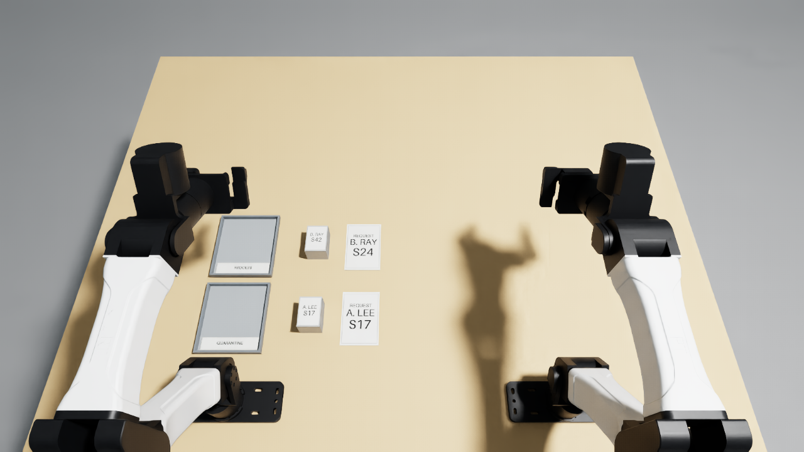

# Check specimen labels against their request forms

Compare **both** patient name and sample ID on each closed container with the
request card beside it. Put exact matches in **PROCESS** and any mismatch in
**QUARANTINE**, upright, released and stable for two seconds.

This task uses two ordinary pick-and-place movements. All geometry and label
textures are original. There are no threads, fluids, compliant parts or asset
downloads. A gray rectangular container represents a sealed specimen pot;
its lid seam is visual and the closed container is one rigid object.

## Fixed layout

Coordinates use the YAM station frame: x forward, y left, z upward, metres.
The table surface is z = 0.7475. Every dimension and material is in `task.json`.

| Container centre (x, y) | Lid label | Request beside it | Correct tray |
| --- | --- | --- | --- |
| (0.160, 0.165) | A. LEE / S17 | A. LEE / S17 | PROCESS |
| (0.320, 0.165) | B. RAY / S42 | B. RAY / S24 | QUARANTINE |

Request cards sit at the corresponding x coordinate and y = 0.070. PROCESS is
centred at (0.320, 0.320), QUARANTINE at (0.160, 0.320). Both trays have identical
shapes and colours; their printed names identify them. The nearest-tray choice
routes both specimens incorrectly. Names and IDs are fictional.

For a physical tabletop reproduction, tape down the trays and request cards,
print the supplied labels, and weight two closed plastic containers to 80 g
with inert ballast. Use no biological samples. Nothing is consumed at reset.

## Scoring

The end score is 0, 0.5 or 1.0. Each correctly routed specimen earns 0.5 after
two continuously measured seconds meeting all of the following conditions:

- Its complete horizontal bounds lie inside its tray's 136 x 120 mm interior.
- Its bottom is within 3 mm of the floor and its upward axis is within 10° of vertical.
- Its speed is below 10 mm/s and angular speed below 0.2 rad/s.
- Its centre moves at most 2 mm and its orientation at most 3° from the hold's anchor.
- Every link of both robots, including each finger, is at least 15 mm clear,
  using conservative link bounds transformed by current physics poses.

A mismatched specimen low in or overhanging PROCESS sets the entire score to
zero, including if it is held or on its side. The exact numeric gate is in
`task.json` and `scoring.in_processing`. This is an end-state rule: the policy
may recover by moving the specimen to quarantine. Moving an already credited
specimen removes its credit immediately. Reset clears all temporal history.

The two-second hold is implemented in `Monitor.update`, called exactly once
after each control step. `score()` and `success()` only read the result.
The native additional success hold is disabled to avoid double counting.
Robot commands in both demos use joint Actions; no object pose correction,
attachment or change to robot drive/contact settings is used.

## Run on Brev

Use the Robocurve YAM launchable. Activate its existing environment first:

```bash
source ~/IsaacLab-Arena/yam.env
cd /path/to/tasks/specimen-label-check
```

Validated environment: inspect-robots 1.0.0, inspect-robots-dream 0.1.0,
isaaclab-arena 0.3.0, isaaclab 17.0.2, NumPy 2.5.4, Pillow 12.3.0;
yam-arena commit `0059d02a1a91bc6834c1d0846022891df0c78730`.

Run scoring and USD hierarchy counterexamples without a simulator (the latter
uses `pxr`, supplied by the launchable or the `usd-core` package):

```bash
python -m unittest discover -s . -v
```

Record three independent resets, including two-second zero-score idle checks,
measured object poses, scoring diagnostics, source hashes and H.264 videos:

```bash
python validate.py --episodes 3 --out ~/specimen-label-runs/validation
```

This runs CPU PhysX **on Brev**, with GPU rendering. It preserves the station's
robot, contact and camera poses. All three cameras render natively at 1280 x
720. `labelkit.py` adds printed visual meshes during spawning and measures
release using the current physics link transforms. Collision shapes are assigned
to their nearest rigid parent, excluding nested links and visual-only meshes.
It never changes an object
pose during a trial. The demo carries containers at 140 mm above the table,
uses finite gripper closure, releases 4 mm above the tray floor, and withdraws
above each tray. Its plan includes a final parking move if success has not
already ended the trial. The right arm remains ready.

To obtain standard Inspect Robots logs and `task_score` results:

```bash
python run_trial.py demo --out ~/specimen-label-runs/inspect-demo
python run_trial.py dream --out ~/specimen-label-runs/dream
```

`run_trial.py` supplies the exact instruction from `specification.py`, fixes
`object_jitter=0`, uses seed 0 and 20 Hz, and sets a 1,200-step limit (60 simulated
seconds). Dream uses the launchable's existing Dream credentials. Its client
resizes observations to 320 x 176; wrist-camera inspection can provide close
views of the small labels. The task does not require the policy to use the
scripted demo's grasps or route order.

Render Inspect Robots recordings with `inspect-robots video <log.json>`.
The validation runner writes videos directly at 5 fps, sampling every fourth
20 Hz observation with the correct playback duration. Its JSONL traces retain
every control step. The run is deterministic for the supplied layout; changing
the seed alone has no scene effect with jitter disabled. Dream's hosted policy
is not deterministic.

## Validation and submission status

All **21 offline checks passed**: 16 scoring counterexamples and five USD
collision-hierarchy regressions. A NumPy kinematic replay of the 40-second
planned path had a maximum position error of 0.084 mm and orientation error
of 0.013°.

Three fresh simulator resets each reached **1.0 at step 672 (33.6 simulated
seconds)**. Each also passed a two-second zero-score idle check. See
[`evidence/validation_repeats.json`](evidence/validation_repeats.json).
After explicitly stating in the instruction that all labels are fictional,
one more run of the final source reached the same result; see
[`evidence/validation_final.json`](evidence/validation_final.json).
Both reports include measured bounds, release checks, temporal holds and
SHA-256 hashes. The final report matches every current Python file and PNG
asset, and confirms none changed during the trial. Geometry, physics and
scoring were identical across these four successful runs. Warm runs took
roughly 2–3 minutes each on the shared Brev L40S; the final recorded run took
185.4 seconds, including startup and idle checks.



Local recordings are under `runs/final/` (ignored by Git), including
`top_cam_0.mp4`, both wrist-camera videos, every-step traces and start/end
images. The top video is H.264, 1280 x 720 at 5 fps, about 1.2 MB. Earlier reset
recordings and their source snapshot are under `runs/repeats/`.

The initial Dream-1 run with no explicit fictional-data sentence ended with
a privacy refusal after 128 steps and **no score**. Its recorded error is in
[`evidence/dream_initial_refusal.json`](evidence/dream_initial_refusal.json).
With the final instruction, Dream-1 completed **1,200 steps**, ended by
`max_steps`, and received **task_score = 0.0** with no policy error. This is a
scored model failure, separate from the earlier unscored refusal. The trial
took 289.8 wall-clock seconds. See
[`evidence/dream_final.json`](evidence/dream_final.json); its native model-view
videos are retained under `runs/dream/`.

Submission media: **M-XXLY2G**, containing the final Dream-1 run, the full-score
scripted demo and the setup screenshot. Videos are uploaded separately;
the local recordings remain outside the Git submission.

## Sources and scope

The identity-checking context is specimen intake; the UW Medicine
[specimen collection guidance](https://testguide.labmed.uw.edu/guideline/specimen_collection)
describes specimen identification and requisitions. This scene tests reading
and comparing two fields, followed by routing; it does not claim clinical
validation or generalization beyond this fixed case.

The import-hook approach is adapted from the existing
`tasks/lock-before-loading/scenekit.py` in this repository. The geometry and
label-generation code are new. Pillow's bundled font creates the PNGs:
`python build_labels.py` (Pillow 10.1 or newer). Checked-in PNGs are sufficient
for running the task; rebuilding is optional. Runtime also uses NumPy and the
Brev launchable's existing packages.

A fresh public PR search found related specimen bagging and leaking-tube
rejection tasks, but no exact two-field request comparison. The signed-in
[task board](https://tasks.robocurve.org/board) redirected to login, so availability
there remains unverified. This implementation is not a reservation of the idea.
