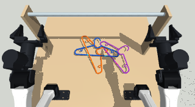

# Untangle three clothes hangers

Untangle the three hangers on the flat worktop and hang each on the closet rail so it can be lifted off on its own.

Orange's open hook passes through the purple frame and catches its trouser bar. Where orange and blue cross, the orange bar rests on top at **65.5°** to blue. One rounded end of blue passes through orange, and the other passes through purple. [Close-up of the orange hook around the purple bar](evidence/crossing.png)



## Recorded trials

| Trial | Score | What happened |
|---|---|---|
| [Dream-1](evidence/model-run.mp4) | **0.0** | At the 800-action limit the robot was still touching purple. None of the three hooks supported a hanger on the rail. |
| [Coordinated demo](evidence/demo.mp4) | **1.0** | The right arm supported purple while the left fed, rolled and lifted the orange hook clear. The arms withdrew the outer frames in sequence and hung all three. All three passed individual removal in the terminal check. |
| [Opposed straight pull](evidence/straight-pull.png) | **0.0** | From the same two-pad grasps, the arms each commanded 130 mm straight outward. Orange's hook slid to purple's rounded shoulder and stayed caught after release. |
| [Untouched reset](evidence/middle-lift.png) | **0.0** | Lifting blue moved orange 66.87 mm and purple 22.56 mm. |
| [Dangling near-miss](evidence/near-miss.png) | **0.0** | Blue hung from the orange trouser bar while orange and purple hung directly on the rail. |

The coordinated run took **755 of 800 actions** (37.75 simulated seconds). At action 128, orange's hook had cleared the purple opening and the purple rim had cleared the crook. In the straight-pull trial, the left and right grippers moved only 51.77 mm and 93.62 mm outward. Both still held their bars at the end of the pull. A subsequent lift of orange moved purple 21.00 mm. [Hook release](evidence/hook-clear.png) · [Staged withdrawal](evidence/after-slide.png) · [Released hangers](evidence/released.png) · [Measurements](evidence/scores.json)

## Reproduce the tangle

Use three molded hangers of the same shape on a 1,100 × 1,100 mm wooden worktop. The geometry reference is the 390 mm polypropylene IKEA SPRUTTIG. The model uses orange, blue and purple frames with two 18 mm bands spaced 150 mm center to center on each trouser bar. Modeled height (194 mm), thickness (4 mm), band widths of the molded profile (8–9 mm), hook span (44 mm), and mass (47 g) are estimates. [Manufacturer's photographs and specifications](https://www.ikea.com/be/en/p/spruttig-hanger-black-20317079/)

Face forward from between the arm bases. Measure x forward, y to the left and height above the worktop. Center the 824 × 25 mm steel rail at x = 405 mm and height 435 mm. It runs left to right between two 100 × 18 × 465 mm timber uprights.

Thread the left end of blue into the orange opening and its right end into the purple opening. Pass the orange hook through the purple opening and catch purple's trouser bar in the crook. Hold the assembly at the following bar midpoints, then release it together and let it settle for 1.8 seconds. Headings are measured from forward toward the left. A positive pitch lowers the positive end of the bar. Roll is about that bar from upright, with +90° turning the hook to your right when you face along the positive bar direction. The angles use intrinsic Z-Y-X order.

| Hanger | x (mm) | y (mm) | Height (mm) | Heading | Pitch | Roll |
|---|---:|---:|---:|---:|---:|---:|
| Orange | 339 | +74 | 59 | 24° | −8.5° | 100.5° |
| Blue | 335 | +9 | 52 | 87.9° | 5° | 83° |
| Purple | 326 | −117 | 54 | 29.5° | 15° | 68.5° |

At the settled bar intersection the orange centerline is 5.08 mm above blue, and the contacting bars transmit 0.448 N of normal force. The orange hook crosses the plane of purple's opening 10.83 mm inside the rim. The purple bar crosses the crook of the orange hook with a 3.72 mm margin. Both the trouser bar and shoulder of each blue end cross the corresponding opening.

## Score

| Score | Test |
|---|---|
| 0 | At least one pair remains caught. |
| 0.5 | All three are separated. A clear plane between the complete shapes of each pair verifies separation. If outlines overlap, all three must pass individual lift tests after release. |
| 1.0 | All three released hangers hang directly by their own hooks. Each can be removed while both others stay on the rail and their bar midpoints each move at most 10 mm. |

After 0.75 s of settling, perform each lift from the same starting arrangement. Off the rail, raise the hanger 65 mm. On the rail, raise it 47 mm, slide it 85 mm toward the straight shank and lower it 48 mm below its starting height. Its crown must finish at least 3 mm below the rail. An independent lift must reach within 7 mm of its requested rise and finish clear of the other hangers and robot. The simulated test hand uses a force-limited 0.68 s stroke and a 0.14 s pause. Hook contact carrying at least 80% of a hanger's weight establishes direct support.

| Hanger removed | Crown below rail | Largest movement of either neighbor |
|---|---:|---:|
| [Orange](evidence/lift-a.png) | 14.78 mm | 2.54 mm |
| [Blue](evidence/lift-b.png) | 14.74 mm | 2.69 mm |
| [Purple](evidence/lift-c.png) | 14.82 mm | 2.69 mm |

## Run locally

Activate the Python 3.12 YAM environment from the program walkthrough. The recorded trials used YAM Arena revision `0059d02`, Inspect Robots 1.0.0, its YAM plugin 0.38.0 and Dream plugin revision `b5e936a`. The station and arm meshes load from YAM Arena. Run the commands from the benchmark repository root, using a fresh output directory for each trial. The model command requires a Dream account with access to Dream-1. [Program walkthrough](https://tasks.robocurve.org/walkthrough) · [YAM station and assets](https://github.com/kairosiann/yam-isaac-lab-arena/tree/0059d02a1a91bc6834c1d0846022891df0c78730) · [Dream policy plugin](https://github.com/kairosiann/inspect-robots-dream/tree/b5e936a201cec66c54c297e522c920d98445e339)

```bash
uv pip install mujoco==3.11.0 scipy==1.17.0 pillow==12.3.0 imageio==2.37.2 imageio-ffmpeg==0.6.0
task_dir=tasks/untangle-clothes-hangers
python "$task_dir/check.py" reset --out runs/hangers-reset
python "$task_dir/check.py" straight-pull --out runs/hangers-pull
python "$task_dir/check.py" near-miss --out runs/hangers-near-miss
python "$task_dir/demo.py" --record --out runs/hangers-demo
python "$task_dir/dream_run.py" --out runs/hangers-dream
```

Seed 0 restores the fixed reset. The two YAM arms use joint targets at 20 Hz with an 800-action limit and 2 ms MuJoCo physics steps. The controller uses fixed waypoints and robot kinematics for the coordinated release. To pick up blue, it locates the two cyan tape bands in the public top-camera image. The evaluator reads object poses and contact forces. A partial demo saves its result and exits with status 1. [Action trace](evidence/trace.jsonl.gz)

The setup screenshot is the first frame of the Dream-1 run from the calibrated top camera. The model received the top, left-wrist and right-wrist streams at 320 × 176. The model video and the 640 × 360 scripted demo each show the top view continuously. The angled close-ups in this README are supplementary simulator views.

The scripted demo took about four seconds of wall time. A second run reproduced its full score and all three lift measurements. Dream-1 used 800 actions in 40 simulated seconds and about 14 seconds of wall time. Replaying its recorded actions reproduced the final top-camera image and score. The setup image and measurements are from simulation. Physical measurements and a hardware photograph are pending.
